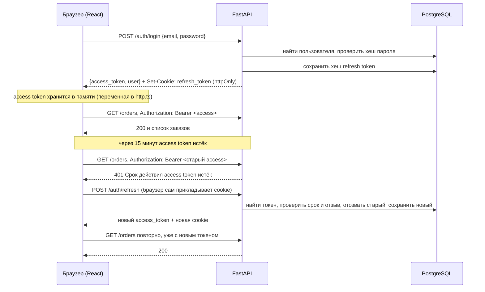

# Отчёт по лабораторным работам №4 и №5

Проект: «Добромаркет» — интернет-магазин товаров для животных с пожертвованиями в приюты.

**Что было до этих работ.** Backend на FastAPI (ЛР №2) умел выполнять CRUD-операции над категориями, товарами, организациями и заказами, но любой мог вызвать любой метод. Frontend (ЛР №1 и №3) работал на демонстрационных данных: файлы `*.data.ts` и имитация сервера в `shared/api/demo.ts`. Отзывы жили только в памяти браузера.

**Что стало.** У магазина есть пользователи, вход по паролю, JWT-токены и две роли — покупатель и администратор. Frontend получает все данные из PostgreSQL через API, а пользователь может создавать, смотреть, изменять и удалять данные в пределах своих прав.

---

## Лабораторная работа №4. Аутентификация и авторизация

### Задание и что сделано

| № | Задание | Как сделано | Где в коде |
|---|---|---|---|
| 1 | Регистрация и вход, пароли в БД в виде стойких хешей | Эндпоинты `POST /api/auth/register` и `/login`. Пароль хешируется алгоритмом **Argon2id**, в таблице `users` лежит только хеш | `backend/app/security.py`, `auth.py`, `routers/auth.py` |
| 2 | Два токена: access (JWT) и refresh, сроки действия | Access token — JWT на **15 минут**. Refresh token — случайная строка на **7 дней**, в БД хранится её SHA-256 | `security.py`, `config.py`, таблица `refresh_tokens` |
| 3 | Обновление access token, отказ при некорректном, истёкшем или отозванном refresh | `POST /api/auth/refresh`: токен ищется в БД, проверяются `revoked_at` и `expires_at`, при ошибке ответ 401 с понятным текстом. Старый refresh token отзывается, выдаётся новый (ротация) | `auth.py` → `refresh_session` |
| 4 | Текущий пользователь, защита маршрутов, публичные и приватные ресурсы, проверка прав на пользовательские данные | `GET /api/auth/me`. Зависимости FastAPI `get_current_user` и `require_admin`. Каталог открыт всем, заказы — только после входа, изменение каталога — только администратору. Чужой заказ или отзыв даёт ответ 403 | `auth.py`, `services.py`, все файлы в `routers/` |
| 5 | Выход: очистка состояния на клиенте и прекращение работы refresh token | `POST /api/auth/logout` записывает в `revoked_at` время отзыва и удаляет cookie. На клиенте стираются access token, данные пользователя и корзина | `routers/auth.py`, `frontend/.../SessionContext.tsx`, `UserMenu.tsx` |

### Как устроены токены



**Access token** — это JWT. В нём три части: заголовок, полезная нагрузка и подпись. Полезная нагрузка у нас такая:

```json
{ "sub": "2", "role": "customer", "type": "access", "iat": 1795016243, "exp": 1795017143 }
```

`sub` — id пользователя, `exp` — момент истечения срока. Подпись создаётся секретом `JWT_SECRET` (алгоритм HS256). Сервер не хранит access token: для проверки ему достаточно сверить подпись и `exp`. Поэтому токен короткоживущий: отозвать его до истечения нельзя, но он сам перестанет работать через 15 минут.

**Refresh token** — случайная строка из `secrets.token_urlsafe(48)`, а не JWT. Всё о нём знает база: чей он, до какого времени действует, отозван ли. Поэтому его можно отозвать в любой момент, это и есть выход.

### Почему сделано именно так

| Решение | Зачем |
|---|---|
| Argon2id для паролей | Алгоритм создан специально для паролей и рекомендован OWASP. Он медленный и требует много памяти, поэтому перебор украденных хешей обходится очень дорого. Соль генерируется для каждого пароля и хранится внутри строки хеша |
| Access token хранится в памяти, а не в `localStorage` | Если на страницу попадёт чужой скрипт (XSS), из `localStorage` он прочитает токен, а из переменной модуля — нет. После перезагрузки страницы токен восстанавливается через `/auth/refresh` |
| Refresh token в cookie с флагом `httpOnly` | JavaScript не видит такую cookie совсем, браузер отправляет её сам |
| `SameSite=Lax` и `Path=/api/auth` | Чужой сайт не сможет отправить POST с нашей cookie (защита от CSRF). Cookie уходит только на адреса авторизации |
| В БД хранится хеш refresh token, а не сам токен | Если таблица утечёт, готовыми токенами воспользоваться не получится |
| Ротация refresh token | Каждый refresh token работает один раз. Украденная копия станет бесполезной, как только владелец обновит токен |
| Одинаковое сообщение «Неверная почта или пароль» | По ответу нельзя узнать, зарегистрирована ли почта |
| `JWT_SECRET` в `.env` | Секрет не попадает в репозиторий. С другим секретом токен не пройдёт проверку подписи |

### Права доступа

| Ресурс | Гость | Покупатель | Администратор |
|---|---|---|---|
| Каталог, организации, отзывы — чтение | да | да | да |
| Товары, категории, организации — создание, изменение, удаление | нет (401) | нет (403) | да |
| Создание заказа | нет (401) | да | да |
| Список заказов | нет (401) | только свои | все |
| Чужой заказ | — | нет (403) | да |
| Изменение заказа | — | свой, пока статус «Новый»: контакты и отмена | любой статус |
| Удаление заказа | — | нет (403) | да |
| Отзыв: создать | нет (401) | один на товар | один на товар |
| Отзыв: изменить | — | только свой | только свой |
| Отзыв: удалить | — | только свой | любой (модерация) |

401 означает «мы не знаем, кто вы» (нет токена или он неверный), а 403 — «мы знаем, кто вы, но вам это нельзя».

Проверка прав на frontend (`RequireAuth`, скрытые кнопки) нужна только для удобства. Настоящая защита — на сервере: запрос в обход интерфейса, например через Swagger или curl, всё равно получит 401 или 403.

---

## Лабораторная работа №5. Интеграция frontend и backend

### Задание и что сделано

| № | Задание | Как сделано |
|---|---|---|
| 1 | Подключить экраны к API, заменить демо-данные данными из PostgreSQL | Удалены `demo.ts`, `DemoModeSwitch.tsx` и три файла `*.data.ts`. Функции в `entities/*/api` вызывают `request()` из `shared/api/http.ts`. Отзывы перенесены в БД (новая таблица `reviews`) |
| 2 | Просмотр, создание, редактирование, удаление через интерфейс с учётом прав | **Покупатель**: оформляет заказ, смотрит свои заказы, отменяет новый заказ, пишет, изменяет и удаляет свой отзыв. **Администратор**: добавляет, изменяет и удаляет товары (`/admin/products`), меняет статус и удаляет любые заказы, удаляет чужие отзывы |
| 3 | Согласовать форматы запросов и ответов, после изменения показывать актуальные данные | Backend отдаёт snake_case (`customer_name`, `unit_price`), frontend использует camelCase. Перевод выполняется в одном месте — в функциях `toOrder`, `toReview`, `toCharity` в `entities/*/api`. После каждого изменения страница заново запрашивает список с сервера |
| 4 | Состояния загрузки, ошибки и отсутствия данных на реальных запросах, понятные ошибки валидации и отказы в доступе | `useAsyncData` + `AsyncContent` работают с настоящими запросами. `ApiError` превращает ответ сервера в понятный текст. Ошибки 422 по полям показываются под нужным полем формы, 401 и 403 — сообщением, гость на закрытой странице попадает на вход |
| 5 | Проверить приложение целиком | Пройдены сценарии ниже, найденные ошибки исправлены |
| 6 | Git, скриншоты, README, запуск по инструкции | README дополнен (API с правами, запуск, демо-аккаунты), в `docs/screenshots` добавлены новые экраны, изменения разбиты на коммиты |

### Как frontend общается с backend

1. В режиме разработки Vite проксирует запросы `/api/*` на `http://localhost:8000` (`vite.config.ts`). Для браузера frontend и API находятся на одном адресе, поэтому cookie работает без сложной настройки CORS.
2. Все запросы проходят через `request()` в `shared/api/http.ts`, который:
   - добавляет заголовок `Authorization: Bearer <access token>`;
   - при ответе 401 один раз вызывает `/auth/refresh` и повторяет запрос;
   - если несколько запросов одновременно получили 401, обновляет токен только один раз (общий промис `refreshing`). Без этого второй запрос пришёл бы со старым, уже отозванным refresh token и выкинул бы пользователя из аккаунта;
   - если обновить не удалось, сообщает `SessionProvider`, что сессия закончилась, и пользователя разлогинивает;
   - превращает ошибку в `ApiError` с понятным текстом и ошибками по полям.
3. `SessionProvider` (`entities/session`) при открытии сайта пытается восстановить сессию через `/auth/refresh`. Пока идёт проверка, статус равен `loading` и закрытые страницы показывают индикатор, а не перекидывают на вход.
4. `RequireAuth` (`app/router`) пускает на `/checkout` и `/orders` только вошедших пользователей, а на `/admin/products` — только администратора. Гостя отправляет на `/login` и запоминает, куда он шёл: после входа он вернётся туда же.

### Проверенные сценарии

Проверка шла на отдельной тестовой базе `pet_charity_shop_test`, рабочая база не менялась.

**API (автотест через FastAPI TestClient, 43 проверки, все прошли):**
регистрация со слабым паролем → 422; регистрация → 201 и httpOnly cookie; повторная регистрация → 409; неверный пароль → 401; `/me` без токена и с мусорным токеном → 401; refresh → новый токен, старый после этого → 401 «отозван»; покупатель создаёт товар → 403; чужой заказ → 403; покупатель ставит статус «Оплачен» → 403; отмена уже оплаченного заказа → 403; второй отзыв на товар → 409; чужой отзыв: изменить → 403, удалить → 403, администратор удаляет → 204; удаление товара из заказов → 409; после выхода refresh → 401.
Отдельно проверено: истёкший refresh token → 401 «Срок действия refresh token истёк», истёкший access token → 401, токен с чужой подписью → 401.

**Интерфейс (в браузере):**
1. Гость добавляет товар в корзину и переходит к оформлению → попадает на страницу входа.
2. Неверный пароль → сообщение «Неверная почта или пароль».
3. Вход → возврат на оформление, имя подставлено из аккаунта, заказ №3 создан в БД.
4. Перезагрузка страницы «Мои заказы» → сессия восстановилась без повторного входа, покупатель видит только свой заказ.
5. Отмена заказа через диалог подтверждения → статус «Отменён».
6. На странице товара кнопки «Изменить» и «Удалить» есть только у своего отзыва. Отзыв изменён и сохранён.
7. Покупатель открывает `/admin/products` → «Нет доступа».
8. Выход → открытие `/orders` перекидывает на вход: refresh token на сервере отозван.
9. Администратор: «Все заказы», добавление товара (сначала пустая форма с ошибками под полями, затем сохранение), попытка удалить товар из заказов → сообщение сервера в диалоге, удаление нового товара.
10. Backend перезапущен с другим `JWT_SECRET`, и старый access token стал недействителен → интерфейс сам обновил токен через refresh и показал данные. В журнале сети: два запроса 401, **один** `/auth/refresh`, два повтора с ответом 200.
11. Мобильная ширина 375 px: шапка, меню и карточки заказов помещаются.

**Что исправлено по ходу проверки.** Старые корзины из `localStorage` хранили товары в демо-формате (категория строкой, а не объектом). Ключ хранилища сменён на `dobromarket-cart-v2`, чтобы старые данные не ломали страницу.

---

## Какие файлы добавлены и изменены

### Backend (`backend/`)

| Файл | Что это | Зачем |
|---|---|---|
| `app/security.py` | **новый** | Хеширование и проверка паролей (Argon2), создание и проверка JWT, генерация refresh token и его хеш. Только криптография, без работы с БД |
| `app/auth.py` | **новый** | Логика авторизации: регистрация, проверка пароля, создание сессии, обновление с ротацией, выход. Зависимости `get_current_user` (кто делает запрос) и `require_admin` (только администратор) |
| `app/routers/auth.py` | **новый** | Маршруты `/api/auth/*`. Здесь же выставляется и удаляется cookie с refresh token |
| `app/routers/reviews.py` | **новый** | Маршруты отзывов: список и создание у товара, изменение и удаление по id |
| `app/models.py` | изменён | Новые модели `User`, `RefreshToken`, `Review`; у `Order` появился владелец `user_id`; у `Donation` — свойство `charity_name` для ответа |
| `app/schemas.py` | изменён | Схемы `RegisterRequest`, `LoginRequest`, `UserRead`, `TokenResponse`, `ReviewCreate/Update/Read`; проверка почты и пароля (буква и цифра, от 8 символов) |
| `app/crud.py` | изменён | Операции с отзывами; список заказов можно отфильтровать по пользователю |
| `app/services.py` | изменён | Заказ создаётся от имени текущего пользователя; проверки «свой ли заказ», «что покупателю можно менять», «кто может менять и удалять отзыв» |
| `app/routers/orders.py` | изменён | Все маршруты требуют вход, удаление — только администратор |
| `app/routers/products.py`, `categories.py`, `charities.py` | изменены | Чтение открыто всем, создание, изменение и удаление — `dependencies=ADMIN_ONLY` |
| `app/errors.py` | изменён | `AppError` умеет передавать заголовки (для 401 нужен `WWW-Authenticate: Bearer`) |
| `app/config.py` | изменён | Настройки `JWT_SECRET`, срок жизни токенов, `COOKIE_SECURE` |
| `app/main.py` | изменён | Подключены новые роутеры, CORS с `allow_credentials` для cookie, `/` перенаправляет на `/docs` |
| `app/init_db.py` | изменён | Флаг `--reset` для пересоздания таблиц |
| `app/seed.py` | изменён | Демо-пользователи (администратор и два покупателя) и отзывы |
| `requirements.txt` | изменён | Добавлены `PyJWT` и `argon2-cffi` |
| `.env.example` | изменён | Пример `JWT_SECRET` и сроков токенов |

### Frontend (`frontend/src/`)

| Файл | Что это | Зачем |
|---|---|---|
| `shared/api/http.ts` | **новый** | Единый клиент API: хранит access token, автоматически обновляет его, повторяет запрос, превращает ошибки в `ApiError` |
| `entities/session/` | **новый** | Сессия пользователя: тип `User`, запросы `login/register/logout/restoreSession`, контекст `SessionProvider` и хук `useSession` |
| `features/auth/LoginForm.tsx`, `RegisterForm.tsx` | **новые** | Формы входа и регистрации с проверкой полей |
| `features/auth/UserMenu.tsx` | **новый** | Кнопка «Войти» или меню пользователя в шапке («Мои заказы», «Управление товарами», «Выйти») |
| `features/auth/useReturnPath.ts` | **новый** | Куда вернуть пользователя после входа |
| `features/manage-products/ProductFormDialog.tsx` | **новый** | Окно создания и редактирования товара |
| `features/manage-order/OrderActions.tsx` | **новый** | Кнопки управления заказом: отмена для покупателя, статус и удаление для администратора |
| `features/review-form/ReviewForm.tsx` | переименован из `add-review/AddReviewForm.tsx` | Одна форма для создания и редактирования отзыва; поле «Имя» убрано, автор берётся из аккаунта |
| `entities/order/ui/OrderCard.tsx` | **новый** | Карточка заказа: номер, дата, статус, состав, пожертвование, итог |
| `shared/ui/ConfirmDialog.tsx` | **новый** | Подтверждение удаления и отмены, показывает ошибку сервера |
| `app/router/RequireAuth.tsx` | **новый** | Закрывает страницы от гостей и не-администраторов |
| `pages/login`, `pages/register`, `pages/orders`, `pages/admin-products` | **новые** | Страницы входа, регистрации, заказов и управления товарами |
| `entities/*/api/*.ts` | изменены | Вместо демо-данных — запросы к API и перевод snake_case в camelCase |
| `entities/product/model/types.ts` | изменён | Категория теперь объект `{id, name}` из БД, цвет фона карточки считается по id |
| `entities/order/model/types.ts`, `entities/review/model/types.ts` | изменены | Типы совпадают с ответами API: статусы заказа, автор и дата отзыва |
| `shared/lib/useForm.ts` | изменён | Ошибки полей из ответа сервера (422) показываются под полями; можно сопоставить имена (`customer_name` → `name`) |
| `shared/lib/validation.ts` | изменён | Правило `sameAs` для повтора пароля, общий шаблон почты |
| `shared/lib/useAsyncData.ts` | изменён | Убрана зависимость от демо-режима |
| `pages/checkout/CheckoutPage.tsx` | изменён | Заказ отправляется на сервер, на экране успеха показываются номер и сумма из ответа сервера |
| `pages/product/ProductReviews.tsx` | изменён | Отзывы из БД, кнопки по правам, редактирование на месте, удаление с подтверждением |
| `features/filter-products/*` | изменены | Категории берутся из данных, фильтр в адресе — по id категории |
| `app/providers/AppProviders.tsx`, `app/router/AppRouter.tsx`, `app/layout/Layout.tsx` | изменены | Подключены `SessionProvider`, новые маршруты и меню пользователя |
| `vite.config.ts` | изменён | Прокси `/api` → `http://localhost:8000` |
| `shared/api/demo.ts`, `app/layout/DemoModeSwitch.tsx`, `entities/*/api/*.data.ts` | **удалены** | Демо-данные больше не нужны |

---

## Как запустить для демонстрации

```bash
# 1. backend
cd backend
.venv\Scripts\Activate.ps1          # PowerShell
pip install -r requirements.txt
python -m app.init_db --reset       # пересоздать таблицы (старые данные удалятся)
python -m app.seed
uvicorn app.main:app --reload

# 2. frontend, в другом терминале
cd frontend
npm run dev
```

Открыть http://localhost:5173. Демо-аккаунты:

| Почта | Пароль | Роль |
|---|---|---|
| admin@dobromarket.ru | admin12345 | администратор |
| anna@example.ru | anna12345 | покупатель |
| igor@example.ru | igor12345 | покупатель |

---

## Вопросы, которые могут задать на защите

**Чем аутентификация отличается от авторизации?**
Аутентификация — проверка, кто вы (вход по почте и паролю, проверка токена). Авторизация — проверка, что вам разрешено (покупателю нельзя менять товары, нельзя смотреть чужой заказ). В коде первое делает `get_current_user`, второе — `require_admin` и проверки в `services.py`.

**Почему пароль не хранится в открытом виде и почему не MD5 или SHA-256?**
При утечке базы пароли сразу оказались бы у злоумышленника, а многие используют один пароль на разных сайтах. MD5 и SHA-256 очень быстрые: видеокарта перебирает миллиарды вариантов в секунду. Argon2 специально медленный и требует много памяти. Соль делает хеши одинаковых паролей разными.

**Как проверяется пароль, если хеш нельзя расшифровать?**
Введённый пароль хешируется с той же солью и параметрами, которые хранятся в строке хеша, и результат сравнивается. Это делает `password_hasher.verify()`.

**Зачем два токена, почему не один?**
Access token проверяется без обращения к БД, поэтому быстрый, но его нельзя отозвать. Поэтому он живёт 15 минут. Refresh token живёт 7 дней, хранится в БД и может быть отозван. Получается быстро, удобно (не нужно входить каждые 15 минут) и безопасно (выход действительно прекращает сессию).

**Что внутри JWT? Его можно подделать?**
Внутри id пользователя, роль, тип токена и сроки. Содержимое закодировано в base64 и не зашифровано: прочитать его может любой, поэтому секретов туда не кладём. Подделать нельзя: подпись создаётся секретом сервера, и при любом изменении содержимого подпись не сойдётся. Проверено: токен, подписанный другим ключом, получает 401.

**Что будет, когда access token истечёт?**
Сервер ответит 401. `http.ts` сам вызовет `/auth/refresh`, получит новый токен и повторит запрос. Пользователь ничего не заметит.

**Что происходит при выходе?**
Сервер записывает в `revoked_at` время отзыва и удаляет cookie. Клиент стирает access token из памяти, пользователя из контекста и корзину. Если кто-то сохранил старый refresh token, сервер ответит «Refresh token отозван».

**Где хранятся токены на клиенте и почему не в localStorage?**
Access token — в памяти (переменная в `http.ts`), refresh token — в httpOnly cookie. `localStorage` доступен любому скрипту на странице, и при XSS-атаке токены украли бы.

**Что такое ротация refresh token?**
При каждом обновлении старый refresh token отзывается и выдаётся новый. Украденный токен сработает не больше одного раза.

**Почему 401 и 403 — разные ошибки?**
401 — пользователь не опознан (нет токена, он неверный или истёк). 403 — пользователь опознан, но прав не хватает.

**Достаточно ли спрятать кнопки во frontend?**
Нет. Это только удобство. Любой может отправить запрос через Swagger или curl, поэтому все проверки продублированы на сервере.

**Как frontend узнаёт, что пользователь уже вошёл, после перезагрузки страницы?**
`SessionProvider` при старте вызывает `/auth/refresh`. Если cookie есть и токен действителен, сервер возвращает новый access token и данные пользователя.

**Зачем прокси в Vite?**
Чтобы браузер считал frontend и API одним сайтом (`localhost:5173`). Тогда cookie с refresh token работает без настройки CORS с credentials.

**Почему сумму заказа считает сервер, а не берёт из корзины?**
Данным от клиента доверять нельзя: цену в запросе можно подменить. Сервер берёт цены из БД (`services.create_order`), а экран успеха показывает сумму из ответа сервера.

**Как согласованы форматы данных?**
Backend отвечает в snake_case (`customer_name`), frontend работает в camelCase (`customer.name`). Перевод выполняется в одном месте — в функциях `toOrder`, `toReview`, `toCharity` в `entities/*/api`. Страницы о формате API не знают.

**Что видит пользователь, если сервер выключен?**
Сообщение «Сервер недоступен…» и кнопку «Повторить» (компоненты `ErrorState` и `AsyncContent`).
